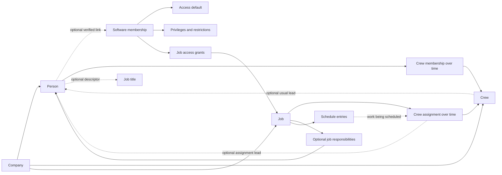

# FieldDive Phase 13C: people, access, and Crew operating model

Research date: September 30, 2026. **Research only; no implementation authorization.**

This report evaluates the approximately 28-person target, the two-person owner-operated business, and the structured small contractor. The prompt also says “68 person” in verdict 18; both 6–8 and literal 68-person interpretations are addressed. Headcount is not treated as a permission requirement.

## 1. Executive conclusion

**The identity and Crew hypothesis survives. The literal three-level access model with one financial toggle does not.** The smallest defensible model is independent people, optional software membership, reusable company-named Crews, optional Crew leadership, explicit work assignments, optional job responsibilities, and separately recorded schedules. Neither titles nor Crew relationships should establish software authority.

**LIKELY / SYNTHESIS:** Owner custody plus two normal non-owner choices can be the default access interface. They cannot be the entire authorization model. “Full team access” can cover a trusted general operator; “Working access” can cover participation on selected jobs. A bounded way to grant company-wide production work without commercial or access-administration powers is still necessary. Assigned-job sales and payment-only work also expose gaps in an inflexible binary. These are action/scope differences, not reasons to name people Office Manager, Production Coordinator, Sales, or Lead.

**Reject one “financial access” privilege.** Customer prices, internal profitability, collecting money, issuing refunds, changing a company price book, paying for FieldDive, and controlling the account are materially different. The smallest practical presentation is a few work-oriented controls, with exceptional authorities kept separate—not a matrix presented during Crew creation. See section 8.

The most consequential findings before Job → Crew implementation are:

1. A Crew and its job assignment must be valid without a Lead or Coordinator. The earlier FieldDive contract's mandatory assignment Lead would impose a responsibility on Tim and Jake that the task explicitly says may not exist.
2. A Crew must be addressable independently of its usual Lead. A person-first board can offer a useful view, but a Crew cannot exist only as a child of a leader. Leaderless Crews and people leading several Crews make that insufficient as the only view.
3. Preserve who was assigned and the roster known at that time. A reusable Crew's current roster is not evidence of who attended a historical job.
4. Work assignment and job access need separate truth. A disclosed, audited sharing rule may connect them; roster membership alone must not grant access.
5. Preserve FieldDive's capability evaluator, scoped grants, restrictions, delegation ceilings, invitations, revocation, custody, and audit infrastructure. Simplification belongs mainly in presentation and reviewed profiles, with a few genuine domain changes.
6. Current proposal authoring reads costs. “Full team access, sensitive financials off” is not currently a truthful promise for proposal authors. A cost-safe data projection is a real prerequisite, not copy work.

These recommendations are **LIKELY / SYNTHESIS**, grounded in the evidence below and the supplied scenarios. They are not claims that contractors prefer a particular label or that a competitor proves market prevalence. The exact defaults require contractor validation.

## 2. Evidence and method limitations

Evidence labels used throughout:

| Label | Meaning |
|---|---|
| **DOCUMENTED** | Official product documentation establishes the described behavior. For local findings, inspected repository source establishes source behavior, not deployment state. |
| **VISUALLY OBSERVED** | An actual published product image was opened and inspected. This establishes visible fields and composition, not hidden validation or enforcement. |
| **LIKELY / SYNTHESIS** | Reasoned conclusion or FieldDive recommendation; not a verified competitor guarantee. |
| **UNVERIFIED** | Public evidence did not establish the answer. Absence of evidence is not absence of a feature. |
| **REQUIRES VALIDATION** | Contractor observation or authenticated product testing is needed to settle the issue. |

Research used official vendor help, product pages, API documentation, developer-owned app listings, and 18 saved images. One contractor job advertisement is included only as a clearly identified anecdote about overlapping responsibilities. No trials, account invitations, contact forms, purchases, emails, or authenticated competitor actions were performed.

AccuLynx's public support link redirected to a Zendesk authentication boundary. Its exact internal role catalog, custom security-role support, internal user title editor, crew validation rules, and historical assignment semantics remain unverified. Public marketing names are not presented as an exhaustive role list. The lookalike domain `www-acculynx.com` and other vendors' comparison claims were excluded as authority about AccuLynx.

The browser runtime could not initialize because of Windows sandbox helper error 206. Public images were instead downloaded from the official pages' image URLs and opened locally with the image viewer. Thus this report contains **visual inspection of published UI imagery**, not a live product walkthrough. The App Store images are currently published but visibly contain 2018/2019 example dates. A 2025 marketing composite contains a 2024 job date. Neither is proof of a current build's behavior.

The repository already contained substantial staged changes and four untracked Phase 13C documents. Reads included the Phase 13 architecture V2, implementation blueprint, Crew reconciliation, Team handoff, current source, and migration files as text. No SQL was executed. Prior documents' reports of staging tests are historical claims, not tests repeated here. Source inspection supersedes stale handoff descriptions for this report; it does not prove staging or production state.

All web sources were accessed September 30, 2026. Dates in the source register are publisher dates when available; crawl dates are not publication dates. Recommendations in later scenario, model, and verdict sections inherit **LIKELY / SYNTHESIS** unless explicitly marked otherwise.

## 3. AccuLynx deep dive

### 3.1 Internal CRM users: what is established

**DOCUMENTED:** AccuLynx describes permissions by role type, configurable by account administrators at setup or later. It mentions owner, manager, sales representative, and office staff as examples, without publishing a complete role enum on that page. This establishes a combination of role categories and permissions, not a clean separation between job title and security profile. [A1](https://acculynx.com/debunking-8-common-myths-about-acculynx-roofing-software/)

**DOCUMENTED:** Company and Location Administrators can create integration API keys in Account Settings. Another official article restricts email-template management to managers or administrators. These are concrete administrative authorities, but do not establish that an Administrator is the legal owner or sole account custodian. [A2](https://apidocs.acculynx.com/docs/authentication), [A3](https://acculynx.com/roofing-communication-tools/)

**DOCUMENTED:** AccuLynx explicitly describes allowing a sales representative to see an assigned job's balance while withholding its profitability. Consequently, internal financial visibility is not an indivisible all-money permission. The same article distinguishes job-linked accounting information from salaries and unrelated business expenses. [A4](https://acculynx.com/quickbooks-integration-benefits-best-practices/)

**DOCUMENTED:** The current plan comparison lists user permission/location settings in both Pro and Elite, while production calendar availability is plan-dependent. A plan entitlement is not a user role. [A5](https://acculynx.com/plan-options/)

| Internal-user question | Finding and confidence |
|---|---|
| Exact normal user/account types? | **UNVERIFIED** complete list. Examples in A1 and named administrator types in A2 are insufficient to claim a canonical Owner/Admin/Manager/Sales/Office hierarchy. |
| Security roles, job titles, presets, or combinations? | **DOCUMENTED** role-type-based configurable permissions; **LIKELY / SYNTHESIS** a combined preset/permission model. Exact mechanics unverified. |
| Custom company job titles? | The official contact API has a string `companyJobTitle`. This proves a contact descriptor; it does **not** prove a title field on internal CRM users. [A6](https://apidocs.acculynx.com/reference/postcontacts) |
| Custom security roles? | **UNVERIFIED.** Changing a user's role type or permissions does not establish custom role creation. |
| Permissions independent of descriptive title? | **UNVERIFIED** for internal users. Contact titles and user permissions occur in different documented surfaces. Do not infer a universal person model. |
| Must employees be labeled Sales/Production/Office? | **UNVERIFIED.** No public evidence proves such a requirement; no evidence establishes its absence either. |
| Who sees financial information? | A4 establishes configurable balance-versus-profit visibility. Exact default matrix, refund powers, billing access, and export leakage require authenticated testing. |
| Who manages users? | A1 establishes administrators assigning/changing user permissions. Detailed delegation ceilings are unverified. |
| Who manages Crews and schedules? | Product pages establish the features. The exact internal role gates are **UNVERIFIED**. Do not convert “production teams” in marketing into a required security role. |
| Owner versus Admin? | Administrative powers are documented; unique custody, transfer, recovery, and owner-count semantics are **UNVERIFIED**. |

### 3.2 Labor resources are not the internal-user directory

**DOCUMENTED:** Labor Manager supports a subcontractor as one crew/resource or a subcontractor managing several crews; records include contact/business documentation and crew trade/color information. Crew App invitations are a subsequent action with controlled information sharing. This establishes labor records that precede app enrollment. It does not establish that every installer has an individual record. [A7](https://acculynx.com/improving-collaboration-with-subcontractors-and-crews/)

**DOCUMENTED:** The developer's current Android listing says subcontractor-permission users manage named, color-coded crews and can add Crew Lead contacts. It describes shared labor orders, calendar/list views, documents, photos, messaging, and checklists. It does not describe a complete installer roster or require every worker to sign in. [A8](https://play.google.com/store/apps/details?hl=en&id=com.acculynx.crew)

| Concept | Publicly supported interpretation | Boundary of the evidence |
|---|---|---|
| Employee | A business relationship, not itself proof of a particular license. | Exact internal-employee labor setup unverified. |
| Internal CRM user | Person with normal AccuLynx access governed by internal permissions. | Employment status does not determine access merely from the label. |
| Subcontractor | Labor contact/business resource; may manage multiple crews. | Whether its principal and internal user can share one underlying identity is unverified. |
| Crew | Named schedulable labor resource. | Not proven to be a complete set of individual workers. |
| Crew App user | Invited participant in the labor-sharing channel. | Not evidence of normal internal CRM membership. |
| Crew Lead contact | Contact relationship associated with a crew. | Contact is not proof of a formal employment title, internal role, or mandatory login. |
| Installer without login | A crew can be represented without inviting every installer. **LIKELY / SYNTHESIS.** | Individual non-login worker roster support remains **UNVERIFIED**. |

A public AccuLynx staff reply dated September 19, 2025 calls Crew App an add-on priced differently from a full user. This supports the separation of product access channels; it does not establish precise licensing terms. [A7](https://acculynx.com/improving-collaboration-with-subcontractors-and-crews/)

### 3.3 Crew creation, lifecycle, and membership

| Question | Evidence-based answer |
|---|---|
| How created and named? | Labor Manager provides subcontractor/crew setup; the app allows subcontractor users to enter a crew name. **DOCUMENTED**, A7/A8. Exact creation form validation was not obtained. |
| Free-form names? | Preferred names are documented; named examples are visible in V1/V7. **DOCUMENTED / VISUALLY OBSERVED.** Length, uniqueness, character rules unverified. |
| Leader required? | Crew Lead columns include blank cells in V1/V7. That proves blanks were displayed, not that every creation/assignment path permits no leader. **UNVERIFIED** mandatory-field rule. |
| Coordinator or Production Manager required? | No evidence establishes this. **UNVERIFIED**, not “definitely optional.” |
| One lead across multiple crews? | **UNVERIFIED** validation/cardinality. |
| Reuse across jobs? | **DOCUMENTED** recurring labor resource and managed-crew scheduling, A8/A9; not a crew record created anew per job. |
| Active/inactive or archive? | Active/non-active filtering is documented in A7. App release notes describe unsharing a crew and reassigning future scheduled work. Do not equate unshare, deactivate, archive, and delete. [A10](https://apps.apple.com/ca/app/acculynx-crew/id1461838352) |
| Changing installer roster? | **UNVERIFIED.** Neither the displayed crew list nor Crew Lead contact proves installer membership management. |
| Person in several crews or outside crews? | **UNVERIFIED** in the labor model. Internal CRM users are a separate concern. |
| Historical assignment preservation? | **UNVERIFIED.** Release notes about reassignment do not prove immutable assignment snapshots or preserved worker identities. |

### 3.4 Job assignment and responsibility

**DOCUMENTED:** The 2019 production update describes a scheduled crew and approved Labor Order producing a Labor Ticket; labor-contact sharing controls exist separately. Treat this as a labor-order/ticket-mediated relationship to the job, not proof of one `crew_id` on the Job. [A11](https://acculynx.com/big-changes-to-production-and-labor-tools-in-acculynx/)

**VISUALLY OBSERVED:** V5 displays distinct Dates, Crew Assignment, Labor Contacts, and Labor Order sections. That is good evidence for separating when work happens, who performs it, and contacts associated with it. It does not reveal which are required.

**DOCUMENTED:** Current Crew App marketing describes job requests that can be accepted/rejected and jobs reassigned among a subcontractor's crews. Assigned work includes dates, address, contacts, instructions, photos, and shared documents. This is evidence for a deliberately shared work view, not automatic whole-job CRM access. [A9](https://acculynx.com/mobile-crew-app/)

**UNVERIFIED:** mandatory office/production job owner; whether a job can save a crew without an internal Coordinator; multiple crews simultaneously on one job versus separate labor orders; exactly who has authority to accept/complete each object; whether an individual internal assignee is mandatory. Public evidence cannot settle these by analogy to FieldDive.

### 3.5 Calendar and scheduling

**DOCUMENTED:** Production combines appointments, deliveries, and scheduled labor; filters and colors help organize it. This is broader than a single job date. [A12](https://acculynx.com/features/roofing-production-management/)

**DOCUMENTED:** The older scheduler update describes drag/drop and date changes, scheduled/unscheduled orders, double-booking alerts, and subcontractor availability setting. Therefore availability is not safely assumed to be only inferred from an empty calendar. The exact availability schema, conflict severity, overlap arithmetic, and whether installer-level conflicts are detected remain **UNVERIFIED**. [A11](https://acculynx.com/big-changes-to-production-and-labor-tools-in-acculynx/)

**VISUALLY OBSERVED:** V3 has named crew lanes, dates, trade bands, and an unscheduled list. V10 shows a mobile month view with company and crew filters. These images prove presentation, not crew capacity, automatic leveling, or exact permissions.

### 3.6 Crew App access and withheld information

**DOCUMENTED:** Inviting the labor resource and specifying shared information/time are explicit steps in the older official Labor Manager guidance. The current product page emphasizes work communication rather than general CRM administration. [A7](https://acculynx.com/improving-collaboration-with-subcontractors-and-crews/), [A9](https://acculynx.com/mobile-crew-app/)

**LIKELY / SYNTHESIS:** The boundary is a curated labor-work view, not unrestricted access to all records of a customer or company. This is the important transferable design principle.

**UNVERIFIED:** exhaustive exclusions for prices, labor rates, profit, internal notes, financial documents, exports, attachments, and account settings. Do not say all money is hidden: sharing an attachment can disclose amounts, and a labor order may legitimately contain commercial information. Authentication testing must inspect the actual shared payload and files.

App release history documents invitation-dependent login and subcontractor unsharing/reassignment behavior. It does not prove that Crew App enrollment creates an internal CRM seat. [A10](https://apps.apple.com/ca/app/acculynx-crew/id1461838352)

## 4. Visual evidence register

Every image below was saved unchanged and opened locally. Images are research evidence, not FieldDive assets. Root: [research image folder](../tmp/fielddive-ui-review/phase13c-people-access-crew-research/). Files should be treated as immutable evidence; no OS read-only attribute or product integration is implied.

### AccuLynx images

| ID / saved image | Source and approximate date | What was visually observed | What it does not prove |
|---|---|---|---|
| V1 [Labor Manager](../tmp/fielddive-ui-review/phase13c-people-access-crew-research/acculynx-labor-manager-2019.png) | [Official original](https://acculynx.com/wp-content/uploads/2019/05/Labor-Manager2.png), A7; May 2019 asset, article updated Nov 2024. Potentially old UI. | Named parent labor contacts; nested crews; trade, status, phone, Crew Lead, app link/invite columns; some empty lead cells. | Mandatory fields; installer roster; actual permission behavior; current UI. |
| V2 [Subcontractor details](../tmp/fielddive-ui-review/phase13c-people-access-crew-research/acculynx-subcontractor-details-2019.png) | [Official original](https://acculynx.com/wp-content/uploads/2019/05/Subcontractor-Details.png), A7; May 2019. | Business contact, Crews & Trades, business documents, separate app invitation. | A normal CRM user, required billing fields, all workers' identities. |
| V3 [Scheduler](../tmp/fielddive-ui-review/phase13c-people-access-crew-research/acculynx-scheduler-2019.png) | [Official original](https://acculynx.com/wp-content/uploads/2019/05/AccuLynx-Scheduler-1024x652.png), A11; May 2019. | Crew names in lanes, color marks, dates and unscheduled work. | Person availability, conflict enforcement or assignment cardinality. |
| V4 [Order Manager](../tmp/fielddive-ui-review/phase13c-people-access-crew-research/acculynx-order-manager-2019.png) | [Official original](https://acculynx.com/wp-content/uploads/2019/05/Order-Manager-1024x652.png), A11; May 2019. | Order status tabs, trade/customer/date columns; material view selected. | Labor assignment behavior merely because a labor selector exists. |
| V5 [Labor Ticket](../tmp/fielddive-ui-review/phase13c-people-access-crew-research/acculynx-labor-ticket-2019.png) | [Official original](https://acculynx.com/wp-content/uploads/2019/05/AccuLynx-Scheduler-w.-Labor-Ticket.png), A11; May 2019. | Separate dates, labor contacts, named Crew Assignment and labor order. Edit controls visible. | Save validation; required Coordinator; order approval powers. |
| V6 [Mobile work view](../tmp/fielddive-ui-review/phase13c-people-access-crew-research/acculynx-mobile-2019.png) | [Official original](https://acculynx.com/wp-content/uploads/2019/05/Hand01-1-207x300.png), A7; May 2019, low resolution. | Job image/address and mobile work controls. | Fine text or any security inference; use V8/V11 for readable detail. |
| V7 [Crew App invitation](../tmp/fielddive-ui-review/phase13c-people-access-crew-research/acculynx-crew-invite-2019.png) | [Official original](https://acculynx.com/wp-content/uploads/2019/05/Invite-to-Crew-App.png), A11; May 2019. | Multiple named crew rows; invitation above rows; empty Crew Lead cells. | Installer roster or proof that a lead is never required. |
| V8 [Current product-page composite](../tmp/fielddive-ui-review/phase13c-people-access-crew-research/acculynx-crew-app-2025.png) | [Official original](https://acculynx.com/wp-content/uploads/2025/03/Mobile-Crew-App_Hero-Graphic_Man-using-his-phone_BW.png), A9; path March 2025, example dates March 2024. Currently published marketing composite. | Text invitation, job dates, instructions, labor quantities, photos; a button labeled Job Complete. | That button closes the entire CRM job rather than reports labor completion; exact release date. |
| V9 [App Store cover](../tmp/fielddive-ui-review/phase13c-people-access-crew-research/acculynx-appstore-1.jpg) | A10, current listing; image date unknown. | Branded promotional cover only. | No functional evidence; deliberately excluded from behavioral conclusions. |
| V10 [App Store calendar](../tmp/fielddive-ui-review/phase13c-people-access-crew-research/acculynx-appstore-2.jpg) | A10; currently published, example June/July 2018. Potentially old. | Month view, colored work marks, company and crew filters. | Multi-company identity/security semantics or current availability rules. |
| V11 [App Store labor details](../tmp/fielddive-ui-review/phase13c-people-access-crew-research/acculynx-appstore-3.jpg) | A10; date unknown, same older promotional set. | Customer/site context, time range, contracting-company contact, labor-order heading. | All accessible fields, prices hidden everywhere, required responsibility fields. |
| V12 [App Store photos](../tmp/fielddive-ui-review/phase13c-people-access-crew-research/acculynx-appstore-4.jpg) | A10; date unknown, potentially old. | Job-specific image gallery. | Visibility for other jobs or upload authorization. |
| V13 [App Store checklist](../tmp/fielddive-ui-review/phase13c-people-access-crew-research/acculynx-appstore-5.jpg) | A10; date unknown, potentially old. | Work checklist with completed/remaining entries. | Worker attendance, individual task assignment or whole-job closeout. |
| V14 [App Store messages](../tmp/fielddive-ui-review/phase13c-people-access-crew-research/acculynx-appstore-6.jpg) | A10; displayed messages March 21, 2019. | Job-specific conversation. | Retention duration or access after removal. |

A10 source: [developer-owned App Store listing](https://apps.apple.com/ca/app/acculynx-crew/id1461838352). Exact CDN URLs for V9–V14 are preserved in [appstore-image-sources.json](../tmp/fielddive-ui-review/phase13c-people-access-crew-research/appstore-image-sources.json).

**Required visual coverage not obtained:** an open crew creation/edit form; a verified roster of individual installers; internal CRM user/permission setup. V1/V7 are crew lists, not installer rosters. V5 shows edit affordances, not the resulting editor. Public searches for Add/Edit Crew and user settings, official pages, app listings, and the support-center attempt did not resolve these gaps. They remain **UNVERIFIED / REQUIRES VALIDATION**; no reconstruction or generated mockup substitutes for evidence.

### Comparator images

| ID / saved image | Source/date | Observation | Limit |
|---|---|---|---|
| V15 [BuildBook roles](../tmp/fielddive-ui-review/phase13c-people-access-crew-research/buildbook-user-roles.png) | B1 official help, Jan 20, 2026; screenshot date unknown. | Open Admin/Member selector on account-user list. | Does not establish every Owner action or current seat limits. |
| V16 [BuildBook project permissions](../tmp/fielddive-ui-review/phase13c-people-access-crew-research/buildbook-project-permissions.png) | B1; same dating limitation. | Per-feature settings; different schedule and financial selections. | Does not prove dependency validation from appearance. |
| V17 [JobNimbus record profile](../tmp/fielddive-ui-review/phase13c-people-access-crew-research/jobnimbus-profile-2024.png) | J1 official help; asset filename Nov 21, 2024. | Editable profile name, record scope, action sliders. | Profile named Owner is not proof of exclusive custody. |
| V18 [JobNimbus feature controls](../tmp/fielddive-ui-review/phase13c-people-access-crew-research/jobnimbus-features-2026.png) | J1 official help; filename Jul 22, 2026. | Separate cost, manual-payment, subscription and settings controls. | Checked boxes are example values, not defaults or tested enforcement. |

Sources: [B1](https://help.buildbook.co/en/articles/10030044-roles-and-permissions-in-buildbook), [J1](https://support.jobnimbus.com/can-i-give-my-team-members-different-access-permissions-in-jobnimbus). Exact image URLs are in [additional-image-sources.json](../tmp/fielddive-ui-review/phase13c-people-access-crew-research/additional-image-sources.json).

## 5. BuildBook comparison

### Account roles and project permissions are different layers

**DOCUMENTED:** The internal Pro Team roles are Account/Team Owner, Pro Team Admin, and Pro Team Member. Owner controls subscription signup/cancellation. Admin accesses all account features but cannot edit plan/billing information. Member accesses Projects, Collections, and Contacts, excluding Opportunities, Estimates, Proposals, and Portfolio. External Collaborators and Clients are project participants, not additional internal access levels. Project feature permissions are configurable; custom account-role creation is **UNVERIFIED**. Full schedule control requires full Tasks, Selections, and Financials permissions; Manage Project requires all features at full access. These dependencies limit simple role comparisons. [B1](https://help.buildbook.co/en/articles/10030044-roles-and-permissions-in-buildbook)

**DOCUMENTED:** Internal invitations offer Admin or Member; removal deactivates membership. This is separate from creating a contact or inviting an external participant. The public management article does not establish every historical-attribution consequence of removal. [B2](https://help.buildbook.co/en/articles/10030045-inviting-and-managing-your-team)

**DOCUMENTED:** Project enrollment is separate from Pro Team enrollment. Collaborators join individual projects and can have different access within them. A collaborator being able to work in a project should not be confused with a read-only role; the feature settings determine permitted actions. [B3](https://help.buildbook.co/en/articles/10029953-invite-people-to-your-project)

### People, descriptors, non-login work, and Crews

**DOCUMENTED:** BuildBook's People directory supports manually entered contacts, custom contact Types, Company, Vendor, and subcontractor insurance-expiration details. Type is a descriptor separate from participation roles. A dedicated internal employee job-title field is **UNVERIFIED**; custom Type is not equivalent to a personal job title. [B4](https://help.buildbook.co/en/articles/10029414-managing-people)

**DOCUMENTED:** Tasks can be assigned to contacts with no access, including people who may never use BuildBook. Invitation remains a separate step. Collaborators' contact choices are limited to the project rather than the entire contact list. This is particularly relevant evidence for Bob's identity and for avoiding directory leaks. [B5](https://help.buildbook.co/en/articles/10029930-assign-tasks)

**DOCUMENTED:** Templates can preserve assignees without automatically inviting them into the new project. [B6](https://help.buildbook.co/en/articles/10029956-using-a-project-template)

**UNVERIFIED:** a first-class reusable Crew with members, usual Lead, assignment snapshots and crew-level capacity. The reviewed People, Tasks, Schedule and roles documentation does not establish one. Do not report that BuildBook has no Crew support.

### What the simplicity costs

**DOCUMENTED:** Invoice access requires full project Financials access and includes creating, editing and sharing invoices. Schedule read/comment users get a calendar rather than the Gantt editor. Global bills/expenses are an admin surface with project-financial access conditions. [B7](https://help.buildbook.co/en/articles/10029908-invoices-overview), [B8](https://help.buildbook.co/en/articles/10029914-schedule-overview), [B9](https://help.buildbook.co/en/articles/10029668-global-bills-and-expenses)

**LIKELY / SYNTHESIS:** BuildBook supports the idea that few account choices can coexist with substantial authority underneath. It does not validate FieldDive's single money toggle. The documented scheduling dependency is a poor fit for a production operator who must not see money. The Member commercial boundary also makes a sales-only employee awkward without another mechanism. Repeated project permission setup can replace role-list complexity with project-administration complexity.

**REQUIRES VALIDATION:** whether Admin project financial access can be independently restricted in all relevant surfaces. B1's broad Admin description and B9's project checks do not establish a complete “Admin minus sensitive financials” guarantee. Test estimates, exports, global bills, and project details together before drawing that conclusion.

## 6. Third comparator: JobNimbus

JobNimbus is the strongest contrast because it is roofing-relevant and exposes action permissions, record reach, financial distinctions, and subcontractor access. CompanyCam's photo emphasis would answer less of the money question; a broad Buildertrend survey is unnecessary here.

**DOCUMENTED:** JobNimbus separates role/seat entitlements from configurable Access Profiles. Its current roles page lists Admin, Sales, Field, and Subcontractor; the latter two are mobile-only. Subcontractor access is bounded to assigned work orders/shared files, excluding general Jobs/Contacts and financials. Do not describe JobNimbus as merely Full/Limited or assume a custom profile overrides license entitlements. [J2](https://support.jobnimbus.com/what-are-user-roles-and-seats)

**DOCUMENTED:** Profiles can be named and customized; record reach and record actions are separate. The help identifies distinct settings for costs, manual payments, subscription and account settings. **UNVERIFIED:** a separate internal job-title field and exclusive Owner custody semantics. [J1](https://support.jobnimbus.com/can-i-give-my-team-members-different-access-permissions-in-jobnimbus)

**DOCUMENTED:** Profit Tracker permissions can distinguish viewing from editing/deleting. Subcontractors may also be contacts assigned to Jobs, including more than one subcontractor, without that contact record itself establishing login access. [J3](https://support.jobnimbus.com/how-can-i-track-my-job-costs-in-jobnimbus), [J4](https://support.jobnimbus.com/how-do-i-add-a-subcontractor-as-a-contact)

**DOCUMENTED:** Groups organize users under managers; group-management relationships expand a limited user's visibility into members' work. They are therefore not neutral operational Crews. [J5](https://support.jobnimbus.com/what-are-groups), [J6](https://support.jobnimbus.com/how-do-groups-affect-access-profile-permissions)

**DOCUMENTED:** Jobs expose assignees, Sales Rep and subcontractors separately. Scheduling and subcontractor notifications are also distinct documented workflows. [J7](https://support.jobnimbus.com/how-do-i-navigate-jobs), [J8](https://support.jobnimbus.com/how-do-i-configure-the-notifications-subcontractors-who-have-been-added-as-contacts-receive), [J9](https://support.jobnimbus.com/calendar-and-tasks)

**LIKELY / SYNTHESIS:** The problems a rigid FieldDive binary misses are a salesperson limited to their jobs, a production operator working across jobs without commercial/admin authority, a bookkeeper without production powers, and an external company principal overseeing several crews. Borrow the separation of scope/action and outside collaboration, not the visible permission matrix or title-like seat labels. JobNimbus shows possible security needs, not how often a 28-person contractor needs each one.

One anecdotal counterexample to role-title equivalence: a September 13, 2026 contractor advertisement labels the position Project Manager while describing sales, inspection, order preparation, scheduling communication, and payment collection. It is an unverified employer advertisement, not a representative survey or proof of product permissions. [R1](https://www.craigslist.org/view/d/san-antonio-roofing-sales/7viyx6eYLvRcgD8SjqqBJy)

## 7. Real-world scenario testing

These are conceptual fit tests, not hands-on competitor tests. “Literal simple” means the proposed three levels with one undifferentiated money privilege and no additional scope/action distinctions. “Recommended” includes the minimum corrections described in this report.

| Scenario | Current FieldDive source / prior contract | Literal simple hypothesis | Recommended model |
|---|---|---|---|
| 1. Tim + Jake | People/Crew foundation fits; Needs a Lead UI and mandatory future assignment Lead impose structure. | Fits if neither leadership nor coordination is required. | Tim and Jake are people; Harris Crew; Crew assigned to Job. No title, Lead or Coordinator needed. Tim acts using custody-backed authority. |
| 2. Lisa handles office work, sensitive money withheld | `admin` largely fits operations, but proposal authoring exposes costs; label Office Manager asserts a title. | “Money off” conflicts with preparing priced proposals. | Full team access with customer-facing proposals; internal costs/profit and collections separately withheld. Requires cost-safe authoring first. |
| 3. Mike runs production | `production_lead` preserves a useful non-commercial operational boundary. | Full may expose proposals and access administration; Working may lack scheduling. | Full if genuinely trusted for broad operations; otherwise Working plus a bounded company-wide production package. Title optional. |
| 4. Carlos usually leads Crew | Usual leadership and `lead_assigned_work` already separate underneath; label Lead conflates them. | Working alone leaves task/start authority unspecified. | Usual Lead relationship plus Working; explicit assigned-work supervision authority when needed. No company-level Lead security role. |
| 5. Bob never logs in | Current `company_people` supports this. Task identity still has login-based limitations. | Fits the identity hypothesis. | Bob remains a person and roster member. Authorized actor records work on his behalf without attributing a login action to Bob. |
| 6. Outside crew, Owner only user | Crew can exist without linked users. Prior future assignment contract still demands a named Lead. | Fits only if unknown installer roster is acceptable. | Named outside Crew, optional principal/contact and optional known members. Owner schedules; no invitations required. |
| 7. Tim wears every hat | Owner capabilities fit; access-derived board groupings can still imply an organization. | Fits. | One person and one custody membership, many independent work relationships. No stacked role labels. |
| 8. Lisa loses access | Disablement, separate handoff, historical membership and people are sound foundations. | Works only if disabling membership does not delete identity. | Revoke membership immediately; preserve person, actor IDs and history; review unfinished work separately. |
| 9. Job needs coordination, no company title | `jobs.assigned_to` now reads Coordinator; not the same as role `production_lead`. | Fits if responsibility remains independent. | Optional job Coordinator points to a person, never determines their title or grants unrestricted powers. |
| 10. Prices/payments but no custody | Several payment/pricing capabilities already distinct; cost hiding and some packages reserved. | Fails with one financial switch. | Grant only the commercial/collection work required; no refund, banking, subscription or access-policy authority implied. |

Competitor fit, bounded by public evidence:

| Scenario | AccuLynx | BuildBook | JobNimbus |
|---|---|---|---|
| 1 | Named labor resources suggest fit; mandatory Lead/Coordinator **UNVERIFIED**. | No-login task assignment fits; reusable Crew **UNVERIFIED**. | Contact/work-order representation plausible; Crew roster **UNVERIFIED**. |
| 2 | Balance/profit separation documented; exact office package **UNVERIFIED**. | Admin-minus-money guarantee **UNVERIFIED**; schedule dependency is a documented obstacle. | Cost control offers relevant separation; full combination requires entitlement/profile testing. |
| 3 | Exact non-commercial operator preset **UNVERIFIED**. | Project scheduling restriction limits fit. | Custom profile likely fits; seat interaction requires validation. |
| 4 | Crew Lead contact and Crew App support relevant relationship; exact mandatory rules unknown. | Task participation documented; usual Crew Lead unknown. | Group manager is an access relationship, not equivalent to usual Crew Lead. |
| 5 | No need established for every installer's account; individual roster unknown. | Explicitly supported for tasks using no-access contacts. | Subcontractor contacts supported; installer roster unknown. |
| 6 | Labor records precede invitation; roster detail unknown. | Contacts can be assigned tasks; group resource unknown. | Subcontractor-contact workflow fits without treating contact as login. |
| 7 | One user's exact combined permissions unknown. | Owner account plus task work fits conceptually. | Configurable profile fits conceptually within seat entitlement. |
| 8 | Historical identity after disablement unknown. | Membership deactivation documented; complete history semantics unknown. | Inactive-user records are referenced in support guidance; complete preservation unverified. |
| 9 | Labor contacts visible; required internal job owner unknown. | Task responsibility exists; separate whole-project coordinator unknown. | Job assignees separate from Sales Rep/subcontractors. |
| 10 | At least some money distinctions documented. | Financial feature dependencies may overgrant. | Several separate money/settings controls documented. |

Evidence for the last table is in sections 3–6; the inactive-user observation is from [J10](https://support.jobnimbus.com/how-do-i-use-board-filters). No cell represents a successful live workflow test.

The practical test is whether a user can stop after recording true facts. “Tim, Jake, Harris Crew, Tuesday” should be complete enough to schedule work. A product may still need an authorized actor to save that information; that requirement does not create an organizational Coordinator.

## 8. Financial-access analysis

### Why one toggle fails

**LIKELY / SYNTHESIS:** “Financial information” conflates information sensitivity, authority to change customer obligations, authority to move funds, and account administration. Seeing a $12,000 proposal is not seeing its $4,000 margin; seeing a payment is not issuing a refund; editing a FieldDive subscription card is not changing customer-payment payout details. The supplied Lisa and money scenarios already require these distinctions. A4, J1/J3 and the local registry provide additional evidence.

The following are semantic boundaries, not a proposed screen full of switches:

| Domain | Minimum distinction and reason | Recommended default / presentation |
|---|---|---|
| Estimate/proposal selling prices | Read amounts; prepare/change prices; send/issue customer-facing commitment are distinguishable actions. A reviewer need not author. | Full team normally prepares/sends ordinary proposals. Working gets none unless granted a scoped commercial package. Explain that proposals include customer prices. |
| Costs and margins | Internal purchase/labor costs and profit can be sensitive even when selling prices are public to the customer. | Owner initially; optional **View costs and profitability**. No claim of hidden costs until all authoring/read paths enforce it. |
| Invoices | Reading invoices differs from creating or changing amounts owed. | Reading approved invoices may accompany collection viewing; issuance/editing is a commercial action. Do not grant it merely to show payment status. |
| Payment status/history | Amount due can support customer communication; full transaction history may disclose more. | **View payments** is separate from collecting. Preserve summary/history distinctions underneath; show a narrow summary option only where a real workflow needs it. |
| Requesting/recording payments | Sending an approved request or logging a received check changes business records; it is not read-only visibility. | **Request payments** separate from viewing history. Recording remains unavailable while the current route/capability is retired/reserved. |
| Refunds/credits | Outgoing money or reduced receivables; higher consequence than collecting. | Owner-only initially; future explicit safeguarded delegation, not included in payment viewing/requesting. |
| Company financial reporting | Aggregated revenue, profit, payroll-like or commission data has wider reach than one job. | Scope explicitly stated. Keep **company-wide** reporting separate underneath; do not activate a nonexistent report privilege. |
| Price book/catalog costs and defaults | Read underlying costs versus alter defaults used by everyone's proposals. | **Manage pricing and templates** remains distinct from ordinary proposal preparation and from cost viewing. |
| SaaS subscription billing | Manages the FieldDive subscription, not customer money. | Owner initially; future explicit billing delegate if needed. No coupling to “View payments.” |
| Banking/payment configuration | Controls collection provider, payout destination, and payment behavior. | Owner-only initially with safeguards; no implicit inheritance from operational Full team. |
| Ownership/security | Custody transfer, recovery and sensitive delegation can change who controls the business account. | Dedicated custody/security operations, not financial access. Ordinary invitations may be bounded delegated work. |

### Smallest workable financial interface

For an ordinary invite, show the chosen access default and a concise explanation. Keep special access in a secondary Owner-controlled area. At the current product boundary the meaningful optional controls are already close to: **View payment history**, **Request payments**, **Manage pricing and templates**, and **Issue scope changes**. Preserve these until a reviewed redesign says otherwise. Their differences are useful; their current role eligibility can change later.

For the future simplified experience, use three understandable subject areas:

1. **Customer prices and proposals:** included in Full team; optional for Working with an explicit job scope and view/prepare/issue consequence.
2. **Internal costs and profitability:** withheld by default; state whether permission is job-scoped or company-wide. Cost visibility does not authorize price-book changes.
3. **Payments and collection:** viewing and requesting are separate named choices. Refunds are excluded.

Price-book administration, subscription billing, payout configuration, custody and security remain separate exceptional authorities. This is the minimum semantic separation supported here, not a claim that exactly three controls solve every money workflow. Read and act must remain distinguishable underneath even if common combinations are presented as packages.

Do not combine internal costs and company-wide reporting into a silent scope expansion. A small business may deliberately grant both through one clearly described package; a user limited to a job must not inherit all-company reports. Likewise, proposals or exported/shared documents can leak costs even when a dashboard hides them. FieldDive's future cost-safe boundary must cover data responses, catalog access, generated PDFs, search, exports, attachments and integrations, not only tabs.

**Current implementation limit — DOCUMENTED locally:** `pricing.cost.read`, `company_financials.read`, `billing.manage`, and `payments.record` are reserved in [registry.ts](../app/lib/access/registry.ts). The refunds capability is active for Owner, while the delegated refunds package is reserved. Reserved labels are not functioning optional privileges. The current proposal pipeline cannot yet deliver the proposed Lisa boundary; preserve honest disclosure until a separately authorized change establishes it.

## 9. Titles analysis

**Recommendation — LIKELY / SYNTHESIS:** support an optional company-defined job title on the person profile when access labels are decoupled. Do not make it a prerequisite for Add person, Crew creation, job assignment, access, or navigation. It is useful when Mike really wants Production Manager or Lisa wants Office Administrator; Tim and Jake can leave it blank permanently.

Use a simple free-text value initially. Suggestions can be examples in help text, not an official role taxonomy or a required dropdown. An autocomplete list based on the company's own existing titles could be considered later if repetition creates a real need. Do not seed a hierarchy that encourages everyone to pick a title.

On the Team Board, an entered title can appear as secondary descriptive text. Show real relationships separately: “Usually leads Carlos Crew” and “Coordinates 3 jobs” are operational facts. Show software access in an explicitly labeled access area; never derive the title from a permission preset. If no title was entered, show nothing rather than “Field,” “Unassigned,” or “Needs title.”

The field introduces modest maintenance: titles can become stale, and one title cannot enumerate every hat. Keep it descriptive and editable without changing historical job responsibilities or access. Do not make filtering, routing or authorization depend on spelling. An audit of title changes may be useful; a full employment-history subsystem is not justified.

**Comparator evidence:** AccuLynx documents a contact job-title string, but an internal-user equivalent is unverified (A6). BuildBook documents custom contact Types, not a proven employee-title field (B4). JobNimbus's custom profile names describe security settings, not independently verified titles (J1). No competitor establishes that titles must be present on the Team Board. The recommendation rests on preserving optional real-world description without security coupling.

**Timing:** title support is not needed to implement durable Job → Crew relationships. Leaving the field absent initially is acceptable if access presets are no longer presented as the person's occupation. Add it in the later person/access simplification work rather than delaying Crew identity or inventing a title automatically.

## 10. Terminology classification

Primary classification uses the requested categories: A durable product concept; B optional company-entered descriptor; C software access level; D job-specific responsibility; E Crew relationship; F unnecessary/misleading. Secondary meanings are explicitly qualified.

| Term | Primary class | Real concept and recommended use |
|---|---|---|
| Owner | A | FieldDive account custodian. Display Owner, explain account custody; legal co-ownership/Partner is a separate descriptor. Not an ordinary invite option. |
| Admin | C | Broad administrative access shorthand. Valid if explicitly scoped; does not mean Office Manager or company ownership. Optional alternative to Full team wording. |
| Office Manager | B | Company's chosen job title. Not required to run proposals/schedules. |
| Production Coordinator | B | Company-wide title if the company uses it. A particular job's coordination is D. |
| Production Manager | B | Descriptive employment title; operational powers granted independently. |
| Lead | F | Unqualified term confuses permission preset, sales lead, Crew relationship and job responsibility. Qualify its context. |
| Foreman | B | Optional company title; may coincide with E/D, never a prerequisite for either. |
| Sales | B | Work descriptor. A job's salesperson may be D when routing/commission evidence requires it. Not sufficient to define security scope. |
| Field | F | Too vague as an access promise or inferred occupation. Can be informal descriptive text, not a reliable permission boundary. |
| Full access | F | Implies custody and unrestricted money. Avoid without a qualifier and explicit exceptions. |
| Full team access | C | Broad normal company operations, with bounded staffing administration; excludes custody and specified sensitive authorities. Validate wording. |
| Working access | C | Participation on granted work by default; enhanced through explicit packages. Must explain job reach and actions. |
| Team member | A | Neutral company/person participation term in UI; not evidence that a login exists. Backend must distinguish software membership. |
| Crew Lead | E | Usual lead of a reusable Crew. On a job, qualify as this assignment's lead (D). |
| Crew member | E | Effective-dated membership of a reusable group; no implied attendance or access. |
| Coordinator | D | Optional person handling job coordination. No company-wide title required. |
| Job owner | F | Ambiguous among customer/property owner, account custodian, salesperson and coordinator. Avoid unless a narrowly defined future workflow needs it. |
| Assignment Lead | D | Optional person directing one assigned work package. Not the Crew's permanent identity and not an access level. |
| Project Manager | B | Company title; a job-specific responsible person can be D without that title. |

This classification does not recommend erasing job descriptions from contractor language. It prevents descriptions from covertly becoming authority or mandatory organization structure.

## 11. Conceptual information model

**LIKELY / SYNTHESIS — conceptual only, no SQL.** Cardinalities describe the recommended domain, not a claim that every relation is implemented.

An assignment may be the reason for an access grant only through a separate authorized sharing policy. The diagram deliberately has no unconditional Crew-membership → access edge.

| Concept | Purpose / required? | Cardinality | Lifecycle and historical truth |
|---|---|---|---|
| Company | Tenant and operational boundary; required. | One company owns many people, Crews, jobs, memberships. | Stable ID; ordinary archive/offboarding must not erase job attribution. |
| Company custody | Protected account control, distinct from legal ownership/title; required. | One current custody anchor under FieldDive's existing invariant; transfer changes the anchor rather than adding an ordinary role. | Audited transfer/recovery; preserve previous custodians and actor attribution. Delegating operations does not transfer custody. |
| Person | Human operational identity; required when a named human is recorded. | One company-scoped person; zero/one current verified login link; many Crew and job relationships. | Create before access; archive separately. Preserve ID in historical relationships. Similar names/phones do not establish sameness. |
| Software membership | Authenticated user's authority in a company; optional for person. | One current company membership per user under today's FieldDive invariant; zero/one per linked person. | Invite/accept, active, disabled, reviewed reactivation. Preserve membership/actor history. Multi-company external login is a separate future decision. |
| Access level/default | Common starting permissions; required for an active membership. | One versioned base profile per membership, not multiple title roles. | Changing default never silently clears restrictions or grants more authority. Retain policy version/audit. |
| Optional privileges/restrictions | Bounded action and resource exceptions; optional. | Zero/many per membership, with scope and validity. | Grant/revoke with provenance and delegation limits. Deny precedence and audit retained. |
| Optional job title | Human description; optional. | Zero/one short current descriptor per person initially. | Editable, blank allowed. Not an authority or responsibility history source. |
| Crew | Reusable operational group/resource; optional until company uses one. | Company has zero/many; Crew may have zero/many known members and jobs over time. | Stable ID, rename/archive. Zero known members means roster not recorded, not nobody worked. |
| Crew membership | Who normally works with whom; optional roster detail. | Many-to-many Person↔Crew, one active occurrence of each pair. | Effective start/end; preserve past rows. Does not establish presence at a job. |
| Usual Crew Lead | Optional default relationship. | Zero/one current usual lead per Crew; person may lead many. | Change affects future defaults, not historical or already accepted assignments. If co-leads are real, use job/task responsibility before inventing mandatory hierarchy. |
| Job | Customer work container; required for job assignments. | One company; zero/many Crew assignments and responsibilities. | Existing lifecycle retained. Closing/reopening must not silently resurrect old access or assignments. |
| Job Crew assignment | Crew undertaking a defined piece/period of work. | Job zero/many over time; Crew many jobs. Domain should allow multiple active work packages, even if first UI exposes one primary Crew. | Version/end changes with crew/name/known-roster snapshot and optional lead. Historical assignment is not live roster lookup. |
| Job-specific responsibility | Who coordinates or directs particular work; optional. | Initially zero/one Coordinator per Job; zero/one assignment Lead per assignment; person many jobs. | Record effective changes and IDs; do not overwrite past accountability. Task assignees remain task-level. |
| Schedule | When work is planned; optional until scheduled. | Job zero/many entries; an entry can refer to an assignment/work package. | Planned dates distinct from actual work/attendance. Rescheduling does not silently change responsibility. Keep one schedule source of truth. |
| Job access grant | What authenticated member can reach; optional, explicit for Working. | Many-to-many membership↔Job, possibly several independent reasons. | Each reason ends independently; disabled membership and restrictions prevail. Preserve audit, not perpetual access. |
| Subcontract business/contact | Distinguishes organization from its people; optional supporting concept. | Business may supply several Crews and have several human contacts. | Start with a simple company descriptor/contact association if sufficient; durable vendor identity needed before compliance, payables or external delegation. Do not make ABC Roofing a fake human. |

### Relationships that must not merge

- Person and authenticated user: Bob exists without a login; Lisa survives disablement.
- Access level and title: Mike can be Production Manager with broad or limited authority.
- Company custody and legal ownership: business partners do not automatically get multiple custody anchors.
- Crew and leader: Harris Crew exists without one; Carlos may lead several.
- Crew membership and job participation: a roster snapshot is a known plan, not attendance.
- Usual Lead and assignment Lead: Tim covering Carlos tomorrow must not rewrite the Crew or yesterday's job.
- Coordinator and Crew/assignment Lead: Lisa may coordinate without working on the roof.
- Responsibility and capability: being named responsible does not authorize every action; having capability does not mean one is assigned.
- Job assignment and schedule: unscheduled assignments and unassigned schedule planning can both be legitimate states.
- Assignment and software sharing: some workers have no login; some authorized observers are not assigned workers.
- Subcontractor principal and Crew: one business/contact can supply multiple operational groups.

### History, multiple Crews, and schedule precision

Do not derive historical workers from today's roster. Preserve the **listed-at-assignment** roster and label it accordingly. Record actual participants later only if the workflow collects them; never claim payroll/time/attendance truth from a Crew assignment.

A usual Lead need not be counted as an installer on the roster: a supervising owner or subcontractor principal may oversee several groups. If the UI offers “also add to Crew,” make that an explicit operational choice. Both relationships must remain within the correct company; neither creates a login or job grant.

Allow a person in more than one Crew: repair work, roofing/gutter crossover, temporary coverage and owner participation are plausible examples. These are **REQUIRES VALIDATION** workflow hypotheses, not prevalence claims. Do not use exclusive membership to solve schedule conflicts. A named person overlapping two assignments is an attention signal, not proof of absence or a hard capacity conflict.

Roofing plus gutters on one customer job is a credible counterexample to a permanent one-active-Crew-per-Job invariant. The smallest correction is an assignment/work-package identity and history that can admit another Crew later. First release may deliberately support one primary Crew, but must state the limitation and avoid presenting it as the enduring business truth. Multiple active assignments also mean an assignment Lead can report their work done without completing the entire Job.

Schedules should continue using the current calendar truth. Before adding several work packages, decide whether existing job dates summarize them or whether assignment-specific intervals become needed. Do not build a second hidden schedule on Crew membership. Availability also includes unrecorded work and leave; empty calendar space is not verified availability.

## 12. Current FieldDive reconciliation

### What is actually present

**DOCUMENTED locally:** the current working tree contains People/Crew foundation files, unlike the older Team handoff's “not a delivered Crew product” description. `/tools/team/page.tsx` renders `TeamBoardClient`. The foundation migration defines `company_people`, `crews`, and effective-dated `crew_members`; the person-details migration adds name/phone editing. These observations do not establish deployed status.

| Layer | Current source truth | Assessment |
|---|---|---|
| Role keys | `owner`, `admin`, `office_sales`, `production_lead`, `field_user`. | Real access profiles, not merely decorative labels. Keep during research. |
| Visible access presets | Office Manager → `admin`; Lead → `field_user` + `lead_assigned_work`; Sales, Production Coordinator and Field are secondary choices. | Titles have become the primary access vocabulary. This is not proof that the underlying permissions are wrong. |
| Capability evaluator | Live membership, active capability, tenant/resource validation, restriction precedence, profile/package scope and dependencies; database decision is authoritative. | Architecturally sound. Do not replace with UI role comparisons. |
| Scope | Company versus granted jobs/job/own task; branch/sales-team scopes reserved. | Preserve. A small role chooser is not sufficient scope enforcement. |
| Packages | Named ordinary/sensitive packages with eligibility and assigner ceilings. | Preserve meaningful boundaries; future eligibility/profile changes need explicit review. |
| People | Independent ID, optional phone/login, archiving, tenant consistency and row versions. | Correct. Current link trigger prevents adding a non-null login to an existing person; later linking is unfinished. |
| Crews | Company-defined active-unique name, nullable usual Lead, separate roster history. | Correct durable core. A nullable lead in storage conflicts with Needs a Lead presentation. |
| Team grouping | `OFFICE_ROLES`, role ranking, and `isCoordinatorEntry` infer office/coordination from access; role label used as work description. | Secure presentation can still assert false organizational facts. Replace these in a later approved UI pass. |
| Weekly Team work | `teamWeek.ts` joins schedule truth to `jobs.assigned_to`. | Coordinator workload, not Crew workload or attendance. Label accordingly. |
| Coordinator | Existing `jobs.assigned_to` user reference is now displayed as Coordinator; old API/file/event names remain. | Do not reinterpret it as usual/assignment Lead. Person-based responsibility would be a future domain change. |
| Legacy Crew text | `jobs.crew_label` survives as legacy text in existing paths. | Never parse it into identity or authorization. Future assignment needs a real relation. |
| Slice 1 | Adds `jobs.complete`; Lead package loses schedule mutation/completion; scoped Start waits for real assignment truth. Directory access narrowed. | Preserve safety boundary; no stand-in from Coordinator or crew name. |
| Invitations | Membership joining and role/package presentation; verified recipient, expiry/revocation/conflict states. | Preserve lifecycle. Future person-linked invitation must join existing identity transactionally rather than duplicate it. |
| Custody/offboarding | Unique Owner anchor, protected transfer/recovery, immediate membership disable and separate handoff. | Preserve. Earlier design text about two-party transfer is not the implemented checkpoint; blueprint §2.9 takes precedence. |
| Job access | Explicit grants and existing task/Coordinator coupling; removal of a responsibility does not necessarily revoke grant. | Keep audited authority; proposed assignment-derived reasons need provenance and clear revocation semantics. |
| Job → Crew | Current foundation explicitly excludes job assignments and crew-derived access. Prior reconciliation specifies future rows/reason ledger. | Future contract, not implemented fact. Reopen product assumptions before hardening it. |

Local evidence: [role keys](../app/lib/companyMembershipRoles.ts), [registry](../app/lib/access/registry.ts), [access presentation](../app/lib/access/teamAccessPresentation.ts), [Team model](../app/lib/team/teamBoardModel.ts), [Team UI](../app/tools/team/TeamBoardClient.tsx), [Team week](../app/lib/team/teamWeek.ts), [person/Crew foundation](../supabase/migrations/20260929130000_phase13c_team_board_people_crews.sql), [person details](../supabase/migrations/20260929140000_phase13c_team_board_person_details.sql), [Slice 1](../supabase/migrations/20260929120000_phase13c_s1_access_vocabulary_completion_split.sql), [evaluator](../supabase/migrations/20260927192000_phase13b_c_access_evaluator.sql), [blueprint](phase13-company-access-user-onboarding-implementation-blueprint.md).

### A–F reconciliation decisions

| Requested category | Recommendation |
|---|---|
| A. Architecturally correct | Separate custody/membership/person; tenant consistency; capability/action/scope distinctions; immutable roster history; optional usual Lead storage; explicit grants; fail-closed reads; secure invitations and revocation. |
| B. Secure but unnecessarily visible | Stored role keys, package dependencies, grant-reason bookkeeping, policy revisions, and delegation tiers can remain behind plain access summaries. A current permission name is not a person's occupation. |
| C. Labels eventually changing | Office Manager/Sales/Production Coordinator/Lead/Field access choices; role-derived office groups; Needs a Lead; invitations saying “join as” a job title. Job Coordinator can remain a qualified responsibility label. |
| D. Capabilities remaining underneath | Separate read/write/send, capture/select, task completion/management, Start/Complete/finalize, schedule read/manage, payment actions, commercial configuration, team delegation, restrictions and dependency checks. |
| E. Actual architecture changes | Optional assignment Lead; assignment identity/cardinality; snapshots/provenance; later person→login linking; cost-safe proposal projection; scope-safe commercial/payment delegation; independent title if adopted. These are not accomplished by renaming presets. |
| F. Can wait for access simplification | New default chooser, title field, preset-label migration, advanced packages, a custom-role designer (not recommended), expanded external-user admission, company-reporting UI. Do not block durable identity on these. |

### Explicit conflicts with the earlier “locked” Crew contract

The user requested that this research challenge prior decisions. This report recommends reconsideration; it does not amend those files or declare new implementation approval.

1. **Part 7 / Part 11: missing usual Lead treated as deficient; explicit assignment Lead always required.** Recommend nullable assignment Lead and neutral leaderless presentation. Required authorization to save work does not require a named field leader.
2. **Part 10: one active assignment per Job.** Acceptable only as a stated first-release limitation; inadequate as the permanent abstraction for multi-trade work. Decide before adding uniqueness constraints.
3. **Part 12: automatic access only for assignment Lead.** Safe as a narrow initial sharing policy, but insufficient for Jake or a logged-in installer doing assigned tasks. Keep roster membership non-authorizing; provide a reviewed per-job participant-sharing path rather than making every worker a Lead.
4. **Part 8 / Slice 7: person linking.** Necessary for “add person now, login later.” The current immutable link rule is deliberately safe but does not implement that lifecycle. Do not claim it already works.
5. **D-S1: only active assignment Lead may Start under job-scoped authority.** Can remain as a narrow supervised-work rule while company-scope actors start leaderless work. If an ordinary participant must Start, add a bounded explicit work responsibility/capability rule later; do not fill a fictional Lead to unlock a button.

The foundation currently gates person/Crew management through company-scope `jobs.assign`. That is an acceptable bounded implementation reuse for now, not proof that people management and job assignment are the same enduring capability. Split only when a real delegate must manage one without the other.

## 13. What the Owner should actually see

**LIKELY / SYNTHESIS — proposed flows, not observed contractor preference.** The backend needs the distinctions above; the ordinary interface should ask only decisions relevant to the current action.

| Adding… | Required decisions | Optional next steps | What should not be required |
|---|---|---|---|
| A. Ordinary Crew worker | Person's name | Phone; add to an existing Crew; optional title in details | Email, login, access level, Lead, Coordinator, security configuration |
| B. Employee who needs FieldDive | Name; choose to give access; invite address; Working or Full team access | Review the jobs/work they need; optional title | Invented occupational title; Crew membership if they do not work on a Crew |
| C. Operational manager | Same identity/invitation flow | Full team access if broad company operations are intended; otherwise Working plus company production responsibility; explicit sensitive privileges where needed | Calling Mike a Production Coordinator to obtain permissions |
| D. Outside subcontract Crew | Company-chosen Crew name | Contact person and phone; subcontractor/business reference; known roster; usual Lead | Installer accounts, complete installer names, internal management hierarchy |

“Add person: Name, phone optional” is sufficient for a person record. “Give FieldDive access” is a separate action, not a checkbox silently checked by Crew membership. Inviting requires an identity-verification/linking process that the current person-link constraint does not yet deliver. Explain invitation status separately from operational status.

“Create Crew: Name” should also be sufficient. Let the Owner add existing people immediately or later. An outside crew can be useful as an operational resource before its full roster is known; do not manufacture an individual named “ABC Roofing” to stand in for a business. A contact person is an actual human; a subcontractor organization is a separate optional reference. Do not make insurance/vendor procurement a prerequisite for the first Crew.

For an ordinary invitation, show two proposed choices with concrete summaries:

- **Working access:** work on the jobs shared with you; no company-wide administration by default. This is a baseline, not a synonym for installer.
- **Full team access:** run normal company operations across jobs, customers, proposals and scheduling. State that this includes customer-facing selling prices. Describe the bounded Team/access administration it actually grants.

Owner should not appear as a third item in that dropdown. Ownership transfer is a separate deliberate operation. A badge can identify the current custodian without asking people to select an organizational title.

Sensitive grants belong in a short separate “Additional access” review by an authorized actor. Do not ask for them during ordinary Crew creation. Show “Off” or “Not supported yet” honestly; an unimplemented cost-hiding policy must not be offered as a working control. Access changes require clear effective scope and an audit record. A summary such as “All company production; no proposals; payment history only” is more useful than a company title.

The normal assignment flow can be: choose Crew, dates if known, save. Expand “Job responsibilities” only when needed for coordination or field supervision. Sharing with a logged-in participant should be visible and reviewable; assigning a non-login person must still succeed. A logged-in participant who needs a stronger action can receive a bounded work grant without being renamed Lead.

## 14. Recommended FieldDive model and conditions of acceptance

**LIKELY / SYNTHESIS:** Adopt the identity and relationship model now as an architectural direction; treat two non-owner access choices as a candidate presentation awaiting validation and a separate access migration design.

The smallest durable structure is a company-scoped **Person**, optional **software membership**, explicit **capabilities and resource scope**, optional **company title**, reusable **Crew**, effective-dated **Crew membership**, optional **usual Crew Lead**, independent **Job–Crew assignment**, optional **job responsibilities**, and **schedule entries**. Custody is a distinct protected company relationship. A subcontractor business may be referenced without being treated as a human or an internal software member.

Two ordinary access defaults are plausible because company-wide operating reach and assigned-work reach are common, understandable starting points. They are insufficient as the entire policy. Preserve a small set of named additions, including company production coordination, assigned-work supervision, and sensitive actions. Do not add a new normal profile merely because a person has another title. Equally, do not hide five required exceptions behind an apparently simple choice: if contractor testing repeatedly needs the same third non-owner bundle, publish that bundle as an access preset with an operational description.

Full team access must not imply custody or unlimited delegation. A bounded administrator may maintain people and invitations within an explicit delegation ceiling. Promotion to Full team access, grants of sensitive privileges, membership restrictions, and ownership transfer are separate authorities; choose and document who can do each. Existing FieldDive delegation protections must survive any label change.

Working access needs both a work scope and appropriate actions. Crew membership alone is neither. Company-wide production without commercial access is a realistic bounded addition for Mike; shared-job proposal editing for a salesperson is another requirement to validate. The current capability registry cannot be assumed to support every proposed scoped commercial combination. That is future authorization work, not an excuse to grant Full team access now.

For money, retain distinct authority over selling/pricing, internal costs/profit, customer invoices/payments, and account custody/configuration. Section 8 describes the smallest UI grouping; write, refund, banking, subscription, and security powers must not be silently bundled into a read grant. These separations follow different assets and consequences, rather than organizational hierarchy.

Lead and Coordinator are optional relationships/responsibilities. Where a responsibility drives access, combine it with active membership, explicit authority and the evaluator; never infer permission from free text. A non-login Lead is operationally meaningful but cannot exercise software powers. A Crew with no Lead and a Job with no Coordinator are valid states, not incomplete setup.

## 15. Answers to the 20 verdict questions

All recommendations below are **LIKELY / SYNTHESIS** unless a stated limitation is **UNVERIFIED** or **REQUIRES VALIDATION**. They are independent verdicts, not approval to implement.

| # | Question | Verdict and boundary |
|---|---|---|
| 1 | Does FieldDive genuinely need more than three normal software access levels? | **Not established.** Evidence does require more than three effective permission combinations. Two ordinary non-owner defaults plus custody and bounded grants are defensible; an exhaustive three-state authorization model is not. Validate repeated exceptions before adding another visible preset. |
| 2 | Should Owner be special custody rather than another selectable role? | **Yes.** Preserve protected transfer/recovery and consistency with current owner membership. Do not pretend changing a dropdown transfers the company. |
| 3 | Can Full Team Access + Working Access cover normal non-owner users? | **Conditionally, as entry choices.** They need resource scope and bounded additions. Mike without commercial access, a scoped salesperson, and a bookkeeper are counterexamples to two immutable permission bundles. |
| 4 | Independent financial privilege? What exactly? | **Independent financial authorities, not one blanket privilege.** Separate selling prices from internal costs/profit; separate viewing customer balances from recording/refunding payments; keep subscription, banking and security/custody distinct. Retain existing action grants and deny unsupported combinations. |
| 5 | Office Manager, Production Coordinator, Lead, Sales, Field primarily descriptors? | **Mostly yes, with distinctions.** Office/Production Manager/Sales can be company titles. Coordinator is also a job responsibility; Lead is a Crew relationship or job responsibility. Field is a work context, not a precise authority. None should silently determine access. Existing presets can persist underneath pending migration. |
| 6 | Optional company-defined job titles? | **Yes, optional and non-authorizing.** Free text; no required taxonomy. It can follow the core identity work. On Team Board, show it as secondary description, clearly separate from access. |
| 7 | Must a Crew have a Lead? | **No.** Usual Lead is nullable; do not render a leaderless Crew as an error. |
| 8 | Must a Crew have a Coordinator? | **No.** A reusable field group does not require a permanent office supervisor. |
| 9 | Must any Crew member have FieldDive access? | **No.** An Owner can schedule an entirely non-login Crew. |
| 10 | Entirely company-defined Crew names? | **Yes.** Apply ordinary safety/length and same-company active-name ambiguity rules; do not impose trade/title naming. Stable IDs carry identity across renaming. |
| 11 | Can one person lead multiple Crews? | **Yes.** An owner/subcontractor principal may oversee several groups. Simultaneous work creates an availability question, not an identity prohibition. |
| 12 | Can one person belong to multiple Crews? | **Yes.** Floating repair staff, split trades and changing combinations justify many-to-many, effective-dated membership. Membership is a usual grouping, not proof of attendance at every job. Warn about actual schedule conflicts where sufficient data exists. |
| 13 | Direct Job → Crew without Coordinator? | **Yes.** Tim can select Harris Crew without creating a separate office assignment. |
| 14 | Which job responsibilities need explicit fields? | Initially an optional **coordination contact** and optional **assignment Lead/field contact**, only where they support handoff, contact or bounded authority. Preserve specific proposal authors/senders and task assignees in their own records. Do not add a universal Job owner or arbitrary responsibility engine without demonstrated need. |
| 15 | Which responsibilities optional? | Both coordination and assignment leadership. A particular task, payment or signed action can require an actor without requiring an organizational role on the whole Job. Multiple roles may reference the same person. |
| 16 | Does Crew assignment create Job access? | **Not intrinsically.** Assignment and authorization remain separate. A deliberate sharing policy may produce a reasoned, scoped grant for active members/participants. Keep revocation source-aware; neither the whole roster nor a non-login Lead automatically becomes a CRM user. |
| 17 | Father/son without invented titles? | **Yes in the recommended model.** Tim has custody, Jake can have no login or Working access, Harris Crew can have no usual Lead, and their Job can have no Coordinator. Current missing-Lead presentation/contract must change before claiming this experience. |
| 18 | Can the “68 person” structured contractor work without enterprise permissions? | **For 6–8 people, plausibly yes; for literal 68, headcount alone cannot decide.** The prompt also targets about 28 people. Test multiple offices, independent sales teams, finance staff and external firms at either size. Those can require scopes/delegation beyond current supported company/assigned-work boundaries, even if the invite screen stays simple. No evidence establishes sufficiency for every 68-person business. |
| 19 | Which current access architecture stays? | Canonical server/SQL evaluator; tenant and active-membership checks; typed scopes; capability dependencies; explicit grants/restrictions; reserved-deny behavior; grant audit; delegation ceiling; custody consistency/transfer/recovery; immediate revocation; historical identity; safe invitation verification. Add reason provenance when automatic sharing requires it. |
| 20 | Smallest durable model? | Person ≠ login; title ≠ permission; Crew ≠ security group; usual Lead ≠ job Lead; Crew assignment ≠ schedule ≠ grant; Coordinator optional; custody protected; two candidate non-owner defaults with explicit scope and a few bounded privileges. Keep histories and subcontractor identity boundaries. |

## 16. Red-team findings

| Attempt to break the recommendation | Result / smallest correction |
|---|---|
| One person wears five hats | Pass if the same Person can hold custody, several responsibilities, and Crew relationships independently. Do not create duplicate people or stack five organizational roles. |
| Nobody has formal titles | Pass with all titles absent. Team navigation and assignment must work without role-derived organizational sections. |
| Two-person company becomes eight, then about 28 | Add people, logins and Crews independently. Introduce optional responsibilities only at real handoffs. Test administrator delegation and production-only reach as the owner delegates. Headcount must not automatically trigger a hierarchy. |
| Mike runs all production but should not see all proposals/customer prices | Literal Full/Working fails. Use bounded company production authority; do not grant broad commercial access or make him an Office Manager. Existing `coordinate_production` is a useful underlying pattern. |
| Lisa prepares proposals but cannot see internal costs | Current implementation does not yet fulfill this separation: authoring reads catalog costs. Requires safe data projection and action enforcement before promising it. A UI toggle alone fails. |
| Carlos delegates field tasks or starts work | Ordinary Working baseline may be insufficient. Add bounded assigned-work supervision or explicit authorized responsibility, not a company-wide Lead role. Validate Start authority independently of ceremonial titles. |
| Jake logs in, is a Crew member, but is not Lead | Assignment-Lead-only automatic sharing fails. Provide explicit participant/task-based sharing. Do not require Jake to become a second Lead. |
| External subcontractor works for several hiring companies | A reusable Crew works locally; current single-company membership constraints may not represent a shared external login. Keep operational records working without login; design an external shared-work channel separately if needed. Do not relax tenant boundaries as a shortcut. |
| Outside crew has unknown/changing installers | Require neither complete roster nor accounts to schedule the resource. Record the known contact and assignment; distinguish known roster from actual attendance. Introduce attendance/workforce records only if payroll, safety or costing needs them. |
| Employee leaves or loses login access | Revoke membership/grants immediately; preserve Person and historic attribution. End current operational membership as appropriate. Do not cascade-delete completed assignments or conflate access removal with human deletion. |
| Owner delegates nearly everything | Broad operations can be delegated, including explicit sensitive privileges. Keep custody transfer separate. If billing delegation is not implemented, say it remains Owner-only; do not enable reserved capabilities to make the UI promise true. |
| Bookkeeper sees payments but not billing/security | Pass only with a payment-read grant plus minimal resource dependencies. Avoid handing out company administration or all jobs' internal details unnecessarily. Review action reach separately from view reach. |
| Someone may collect a payment but must not refund it | A single financial toggle fails. Collection/request, manual recording, refund and payment-configuration authorities remain distinct. |
| No Crew member has software access | Pass. Authorized Owner/office operator schedules and records work; operational assignment alone creates no login. |
| Job has Crew, no Coordinator and no Lead | Pass operationally. An authorized company-scope user can perform required software actions. No fabricated person is necessary to satisfy a not-null field. |
| Roofing and gutter Crews work on one Job at different times | A permanent one-active-Crew-per-Job model fails. Permit separate assignments/work packages over time; concurrent packages may be needed. A limited initial UI must disclose its limitation rather than encode universal exclusivity. |
| Crew roster/Lead changes after completion | History fails if rendered from current Crew only. Preserve assignment-time lead, relevant participant evidence and effective dates. Decide whether roster snapshot or dated join is sufficient; never invent historical attendance from today's roster. |
| Same worker is in two Crews on the same day | Membership model passes; naive crew-only scheduling fails to detect individual overlap. Warn where actual intended participants are known. Do not assume all roster members attend every assignment. |
| Assignment ends while a manual job grant remains | Single-source grant deletion fails. Preserve independent active reasons; only remove assignment-derived access. Restrictions and disabled membership still override. |
| Office operator can invite someone with more power than themselves | Unbounded Full team administration fails. Preserve delegation ceilings and Owner review for sensitive/elevated grants. Roster management and security administration are different actions. |
| Multi-location contractor partitions sales/customer lists | Two company/assigned-job scopes may be insufficient. Validate branch/team scopes before promising coverage; current reserved scope types are not delivered functionality. This is not solved by a free-text title. |

The proposed model therefore survives as an identity/relationship design and a simple invitation starting point. It does **not** survive as two immutable non-owner permission bundles, one financial checkbox, mandatory assignment leadership, or permanent one-Crew-per-Job exclusivity.

## 17. What NOT to change yet

1. Do not rewrite the canonical evaluator, capability identifiers, tenant checks, explicit restrictions, audit trail, or custody machinery for cosmetic simplicity.
2. Do not rename stored role keys or remap existing users during Crew work. A later access migration needs an effective-permission comparison, existing overrides, invitation compatibility, rollback and no silent expansion.
3. Do not turn reserved financial/scope capabilities on merely because the model names them. A privilege requires enforced data/action paths, not a label.
4. Do not build a general custom-role editor, organization chart, arbitrary workflow engine, payroll/attendance system or multi-tenant subcontractor portal from this research alone.
5. Do not require titles, roster completeness, Crew app accounts, Lead or Coordinator to create a Crew.
6. Do not replace a secure access boundary with a title check or a Crew-name comparison.
7. Do not migrate current `jobs.assigned_to` or `crew_label` data by guessing a human/Crew identity from display names. Reconcile ambiguous records explicitly in a later implementation plan.
8. Do not delete or overwrite the earlier architecture documents. This report records disagreements for decision; it does not silently revise the approved implementation record.

Optional title UI, access-preset naming and broad financial-access redesign can wait. The relationship/cardinality/history decisions below cannot safely wait until after Job → Crew persistence hardens.

## 18. Decisions required before Job → Crew implementation

| Decision | Research recommendation | Why it is a prerequisite |
|---|---|---|
| Is leadership required? | No: nullable usual and assignment Lead; distinguish optional contact from privileged actor | A mandatory foreign key or workflow gate forces invented hierarchy |
| What does an assignment identify? | Crew plus job/work package and effective lifecycle; not just current roster or a display string | Determines multi-trade work, replacements and historical truth |
| One assignment or several? | Model multiple over time; explicitly decide concurrent work packages now | Avoid a permanent uniqueness rule that excludes roofing plus gutters |
| Coordinator reference | Optional person responsibility, independently linked to software access | Existing login-based `assigned_to` cannot represent every non-login operational contact |
| Crew roster versus actual workers | Roster is reusable/default composition; do not assert attendance | Prevent inaccurate labor history and misleading conflict warnings |
| Lead/roster changes | Affect future defaults; preserve prior assignment facts; explicit reassignment for current work | Avoid rewriting who was responsible yesterday |
| Does assignment share anything? | Decide explicit policy and exposed data; default no implicit whole-roster grant | Operational assignment must not leak CRM/financial data |
| Multiple grant reasons | Preserve manual, task, responsibility and assignment reasons independently | Revoking one source must not revoke another legitimate source |
| Non-login person becomes user | Verified same-person linking, collision resolution, transactional acceptance and audit | Current immutable linkage otherwise risks duplicate identities |
| Who can act on leaderless work? | Company-authorized operator; explicit bounded participant powers where needed | Optional lead cannot leave Start/progress/task actions unreachable |
| Archive/disable behavior | Separate access revocation, roster ending and record archival; protect live work references | Security and operational lifecycle differ |
| External resource minimum | Crew name plus optional human/business contact, no required accounts | Supports owner-scheduled subcontract labor from day one |
| Normal calendar meaning | State whether it schedules a job, Crew assignment or work package; show actual resource names | Current Coordinator-based week view is not Crew availability |

A decision can be “limited first release” where appropriate, but the limitation must be visible and must not corrupt identity/history. None of these recommendations authorizes implementation in this task.

## 19. Questions requiring contractor or authenticated product validation

**REQUIRES VALIDATION:** Public competitor material establishes possibilities, not what small contractors prefer or how often arrangements occur. Use concrete recent jobs and actual handoffs rather than asking whether users like abstract role names.

- With a two-person owner/operator: create their people, Crew and next job with every title/Lead/Coordinator absent. Observe whether any missing fact prevents useful work.
- With a 6–8-person and an approximately 28-person contractor: identify who really schedules, prepares prices, changes prices, sees supplier costs, requests payment and issues refunds. Test those actions separately.
- Ask Lisa to prepare a real proposal while hiding internal costs. Determine exactly which totals, catalog details, attachments and exports would reveal costs; test the complete authoring path.
- Ask Mike what company-wide information he needs and what he should not see. Determine whether a production addition is understandable or becomes a repeatedly needed normal preset.
- Have Carlos and Jake each complete ordinary field work. Determine whether Start, task delegation, photos, material requests and closeout require different bounded authorities.
- For an outside crew, ask who knows the installer names, who uses a phone, who accepts a work order and whether the principal works for several hiring firms. Validate the minimum useful record and sharing channel.
- Review jobs involving reroof, gutters, repairs and subcontractor replacement. Determine concurrent Crew needs, assignment segments, lead changes and historical disputes.
- Inspect owner delegation and absence: who may invite, remove, promote, inspect payment history, change bank details or cancel subscription? Separate emergency recovery from everyday delegation.
- Test Crew rename, worker transfer, access removal, rehire and later invitation of an existing person. Ask users which historical names/responsibilities they expect to remain visible.
- Ask whether optional titles help distinguish people on Team Board or become stale. Do not infer title usefulness from competitors' contact fields.
- In authenticated AccuLynx, validate the actual current user-role list, editable permissions, custom role/title support, crew creation requirements, installer membership, cross-crew membership, historical behavior and job-sharing revocation. Inspect internal-user administration separately from Labor Manager/Crew App.
- In authenticated BuildBook, verify whether an Admin can be withheld project/company financial data while retaining necessary estimating and scheduling work. In JobNimbus, verify current seat/profile interaction and cost-hiding across exports and mobile surfaces.

Acceptance evidence should be recorded as completed tasks and observed access outcomes, not an unsupported statement that “contractors prefer three roles.” Include both no-title owner/operators and businesses with delegated operations. If literal 68-person coverage is required, add a multi-location/segregated-team case rather than extrapolating from eight people.

## 20. Source register

All web sources were accessed **2026-09-30**. Dates below are displayed publication/update dates where captured; an undated page is not evidence that the feature is newly released. “Official” identifies provenance, not independent proof that every deployment behaves identically. Product screenshots and exact downloadable image provenance are recorded in section 4 and the two image manifests. No community claim is used to establish a product permission boundary.

### AccuLynx

| ID | Source | Date / evidence quality |
|---|---|---|
| A1 | [Debunking eight myths](https://acculynx.com/debunking-8-common-myths-about-acculynx-roofing-software/) | Published 2024-04-10; updated 2025-02-06. Official explanatory marketing; role-type configuration, not exhaustive permission reference. |
| A2 | [API authentication](https://apidocs.acculynx.com/docs/authentication) | Undated official technical documentation; specific integration-administration authority. |
| A3 | [Roofing communication tools](https://acculynx.com/roofing-communication-tools/) | Publication/update date not captured. Official workflow article; narrow template authority example. |
| A4 | [QuickBooks integration benefits and practices](https://acculynx.com/quickbooks-integration-benefits-best-practices/) | Published 2017-07-06; updated 2025-09-25. Official financial-visibility example; not exhaustive current permissions. |
| A5 | [Plan options](https://acculynx.com/plan-options/) | Undated current public plan page. Entitlement comparison, not per-user authorization. |
| A6 | [Create contact API](https://apidocs.acculynx.com/reference/postcontacts) | Undated official API reference. Contact title field only. |
| A7 | [Subcontractors and crews](https://acculynx.com/improving-collaboration-with-subcontractors-and-crews/) | Published 2019-05-22; updated 2024-11-05. Official article and dated UI assets. Staff reply 2025-09-19 is supplementary licensing context. |
| A8 | [Android Crew App listing](https://play.google.com/store/apps/details?hl=en&id=com.acculynx.crew) | Developer listing updated 2026-07-14. Current published feature description; no authenticated test. |
| A9 | [Mobile Crew App](https://acculynx.com/mobile-crew-app/) | Undated current official marketing. Web extraction intermittently returned 504; indexed text and public page/image retrieval supplied evidence. |
| A10 | [Apple Crew App listing](https://apps.apple.com/ca/app/acculynx-crew/id1461838352) | Official developer listing with version history. Relevant dated notes: 2019-06-05, 2019-08-21, 2020-02-27. Current listing retains visibly older screenshots. Top version's “Mar 6” year was not established. |
| A11 | [Production and labor tools update](https://acculynx.com/big-changes-to-production-and-labor-tools-in-acculynx/) | Published 2019-05-15; updated 2024-11-05. Official explanation plus 2019 UI; do not treat update stamp as screenshot freshness. |
| A12 | [Production management](https://acculynx.com/features/roofing-production-management/) | Undated current official feature page; high-level scheduling evidence. |
| A13 | [Support entry point](https://acculynx.com/support/) | Current official entry point leads to authenticated support. Detailed internal configuration unavailable publicly in this research. |

### BuildBook

The nine help articles below displayed **January 20, 2026**. They are official product documentation, more specific than marketing. Their role/project dependencies matter; none was authenticated or exercised live.

| ID | Source | Evidence use / limitation |
|---|---|---|
| B1 | [Roles and permissions](https://help.buildbook.co/en/articles/10030044-roles-and-permissions-in-buildbook) | Internal defaults and project-feature configuration; inspected two screenshots. Not proof of a customizable account-role engine. |
| B2 | [Inviting and managing your team](https://help.buildbook.co/en/articles/10030045-inviting-and-managing-your-team) | Invitation and deactivation; not complete historic attribution semantics. |
| B3 | [Invite people to your project](https://help.buildbook.co/en/articles/10029953-invite-people-to-your-project) | Project participant enrollment distinct from internal team enrollment. |
| B4 | [Managing people](https://help.buildbook.co/en/articles/10029414-managing-people) | Contact descriptors and vendor context; not internal job-title proof. |
| B5 | [Assign tasks](https://help.buildbook.co/en/articles/10029930-assign-tasks) | Non-login operational assignees and contact scope. |
| B6 | [Using a project template](https://help.buildbook.co/en/articles/10029956-using-a-project-template) | Assignment can persist without automatic invitation. |
| B7 | [Invoices overview](https://help.buildbook.co/en/articles/10029908-invoices-overview) | Invoice action dependency on Financials. |
| B8 | [Schedule overview](https://help.buildbook.co/en/articles/10029914-schedule-overview) | Scheduled item types and permission-dependent presentation. |
| B9 | [Global bills and expenses](https://help.buildbook.co/en/articles/10029668-global-bills-and-expenses) | Global administration and project-financial conditions. |

### JobNimbus and supporting contractor signal

| ID | Source | Date / evidence quality |
|---|---|---|
| J1 | [Different team permissions / Access Profiles](https://support.jobnimbus.com/can-i-give-my-team-members-different-access-permissions-in-jobnimbus) | Undated official help. Inspected embedded assets dated 2024-11-21 and 2026-07-22 by URL; asset date is not a release guarantee. |
| J2 | [User roles and seats](https://support.jobnimbus.com/what-are-user-roles-and-seats) | Undated official current help; entitlement boundary separate from profiles. |
| J3 | [Track job costs](https://support.jobnimbus.com/how-can-i-track-my-job-costs-in-jobnimbus) | Undated official help; profit authority distinctions. |
| J4 | [Subcontractor as contact](https://support.jobnimbus.com/how-do-i-add-a-subcontractor-as-a-contact) | Undated official help; operational record separate from user seat. |
| J5 | [Groups](https://support.jobnimbus.com/what-are-groups) | Undated official help; managerial grouping, not neutral Crew proof. |
| J6 | [Groups and Access Profiles](https://support.jobnimbus.com/how-do-groups-affect-access-profile-permissions) | Undated official help; manager visibility effects. |
| J7 | [Navigate Jobs](https://support.jobnimbus.com/how-do-i-navigate-jobs) | Undated official help; distinct job participant fields. |
| J8 | [Subcontractor contact notifications](https://support.jobnimbus.com/how-do-i-configure-the-notifications-subcontractors-who-have-been-added-as-contacts-receive) | Undated official help; notification separate from membership. |
| J9 | [Calendar and tasks documentation](https://support.jobnimbus.com/calendar-and-tasks) | Undated official documentation index; high-level scheduling only. |
| J10 | [Board filters](https://support.jobnimbus.com/how-do-i-use-board-filters) | Undated official help. Inactive-user filtering supports retained references, not a complete identity-retention guarantee. |
| R1 | [Response Roofing recruiting advertisement](https://www.craigslist.org/view/d/san-antonio-roofing-sales/7viyx6eYLvRcgD8SjqqBJy) | 2026-09-13, San Antonio. Employer-posted anecdote: broad responsibilities under one title. Not representative research; link may expire. |

### FieldDive repository evidence

Read at the workspace state on **2026-09-30**. This tree already contained substantial staged work and untracked architecture documents. Evidence is from files present locally, not proof of deployment. SQL migrations were read as text only; no SQL was run. A historical document's “locked” language is recorded as prior intent, not immune from the user's explicit research challenge.

| ID | Local source | Evidence use |
|---|---|---|
| F1 | [Architecture v2](phase13-company-access-user-onboarding-astra-architecture-v2.md) | Prior access/custody direction; distinguish historical intent from current implementation. |
| F2 | [Implementation blueprint](phase13-company-access-user-onboarding-implementation-blueprint.md) | Access invariants, custody, delegation and implementation checkpoints. Later checkpoint statements qualify earlier aspirational transfer/MFA descriptions. |
| F3 | [Crew contract reconciliation](phase13c-crew-product-contract-repo-reconciliation.md) | Planned assignments, required Lead, reason ledger, historical lifecycle and later person linking. |
| F4 | [Team implementation handoff](phase13c-team-astra-implementation-handoff.md) | Earlier baseline; newer files contain foundation work beyond its status. |
| F5 | [Unavailable Owner recovery](phase13f-unavailable-owner-recovery.md) | Custody recovery boundary. |
| F6 | [Membership roles](../app/lib/companyMembershipRoles.ts), [capability registry](../app/lib/access/registry.ts), [access presentation](../app/lib/access/teamAccessPresentation.ts) | Current stored roles, capability/package vocabulary, user-visible presets. |
| F7 | [Access resolver](../app/lib/access/resolveAccess.ts), [canonical evaluator migration](../supabase/migrations/20260927192000_phase13b_c_access_evaluator.sql) | Authorization precedence, scopes, restrictions and dependencies. Read-only inspection. |
| F8 | [Slice 1 access vocabulary migration](../supabase/migrations/20260929120000_phase13c_s1_access_vocabulary_completion_split.sql) | Start/progress versus completion and supported/reserved vocabulary. Read-only inspection. |
| F9 | [People/Crew foundation](../supabase/migrations/20260929130000_phase13c_team_board_people_crews.sql), [person details](../supabase/migrations/20260929140000_phase13c_team_board_person_details.sql) | Actual person, linkage, Crew, membership, lifecycle constraints. Read-only inspection. |
| F10 | [Team model](../app/lib/team/teamBoardModel.ts), [Team persistence](../app/lib/team/teamBoardPersistence.ts), [Team week](../app/lib/team/teamWeek.ts) | Operational data shapes, inferred office groupings, Coordinator-based schedule joins. |
| F11 | [Team page](../app/tools/team/page.tsx), [Team Board client](../app/tools/team/TeamBoardClient.tsx) | Current route and wording, including missing-Lead presentation. |
| F12 | [Invitation model](../app/lib/invitations/invitationModel.ts), [Job Coordinator control](../app/tools/roofing/jobCard/JobCardProductionLeadControl.tsx) | Current invitation semantics and login-based Coordinator control. |

## 21. Final decision table

**Reading the table:** Current FieldDive means inspected local files, not deployed behavior. Proposed means **LIKELY / SYNTHESIS**, with unimplemented access combinations explicitly conditional. Competitor facts are **DOCUMENTED** in sections 3–6; **VISUALLY OBSERVED** evidence is in section 4. “Unverified” is not “absent.” Complexity assessments are synthesis, not measured usability or numerical scores.

| Dimension | Current FieldDive model | Proposed simple model, corrected by research | AccuLynx | BuildBook | JobNimbus |
|---|---|---|---|---|---|
| Internal software access | Five stored roles; named packages, overrides and scopes; occupational preset labels | Two candidate non-owner defaults plus protected custody, scope and bounded additions; not three exhaustive permission states | Role-type permission configuration; exact current enum/custom roles unverified (A1–A2) | Three internal defaults plus project feature permissions (B1–B3) | Seat/role entitlements plus customizable profiles and reach/actions (J1–J2) |
| Job titles | Access-derived labels; no optional person title in inspected foundation | Optional free-text descriptor, independent of access | Contact title API documented; internal-user title unverified (A6) | Custom contact Type documented; dedicated employee title unverified (B4) | Independent employee title unverified |
| Non-login people | Nullable linked-user Person exists; later linking remains a gap | First-class Person; verified optional later membership; history retained | Labor contacts exist before app invitation; installer-level person roster unverified (A7) | No-access contacts can receive tasks (B5–B6) | Subcontractor contacts distinct from software seats (J2,J4) |
| Crew model | Named Crews, many-to-many dated membership, optional usual Lead | Reusable neutral operational group; known roster can be incomplete | Labor resource/subcontractor and multiple crews; full installer roster unverified (A7–A8) | Dedicated reusable labor Crew model unverified | Managerial Groups and subcontractor contacts documented; neutral roster Crew model unverified (J4–J6) |
| Crew naming | Company-entered name, active-name uniqueness | Company-defined, stable ID across rename | Named crews documented/visible; exact validation unverified (A8,V1) | Not established | Neutral Crew naming not established |
| Usual Crew Lead | Nullable relation; UI/older contract treats absence as needing attention | Optional Person relationship; may lead several Crews; no access implied | Lead contacts and blank cells observed; requirement/multiplicity unverified (A8,V1) | Not established | Not established as neutral Crew relation |
| Job assignment | Coordinator via `assigned_to`; durable Crew assignment planned | Job/work-package → Crew, optional lead, multiple historical assignments; concurrency decision required | Labor order/ticket and scheduled Crew; not proven one Job FK (A11,V5) | Project participants/task assignees; dedicated Crew assignment unverified (B3,B5) | Job assignees, Sales Rep and subcontractors distinguished (J7) |
| Job responsibility | Login Coordinator; future assignment Lead required by prior contract | Optional coordination and field contact; same person can fill both; specific actor records retained | Labor/contact distinctions; mandatory office owner/coordinator unverified | Project management permissions and task assignment; mandatory office coordinator unverified | Separate job participant fields; exclusivity/custody not established |
| Scheduling | Team week currently uses Coordinator; Crew workload not delivered by that join | Schedule explicit job/work package/resource; name Crews directly; known-participant conflicts separate | Labor, appointments and deliveries; crew lanes/conflicts/availability (A11–A12,V3) | Tasks/phases and other dated project items; feature dependencies (B1,B8) | Calendar/task workflows documented; resource-conflict specifics unverified (J9) |
| Financial visibility | Multiple capabilities/packages; some reserved; authoring cost separation not delivered | Prices, cost/profit, receivables and sensitive actions distinguished; billing/banking/custody separate | Assigned-job balance versus profitability separation documented (A4) | Financials feature controls and dependencies; Lisa's full workflow with hidden finance unverified (B1,B7,B9) | Distinct costs, profit, payment and subscription settings (J1,J3,V18) |
| Company administration | Owner custody and bounded delegated administration; evaluated grants/restrictions | Preserve custody, delegation ceiling, security and audit; simplify presentation later | Company/Location administration documented; Owner custody equivalence unverified (A2) | Owner subscription authority versus Admin; Member narrower (B1) | Settings/subscription profile controls; exclusive custody semantics unverified (J1) |
| Subcontractors | Local non-login people/Crews possible; shared multi-company external login not solved | Outside Crew can operate without logins; business/contact references; later explicit shared-work channel if needed | Separate labor/Crew App workflow, invitations and shared work (A7–A10) | Contacts and project collaborators; dedicated multi-Crew labor management unverified (B3–B5) | Operational contacts or bounded subcontractor seat; distinguish them (J2,J4) |
| Complexity imposed on user | Role-like occupational labels and Lead warnings can imply an organization; strong engine underneath | Minimal person/Crew creation; access only when invited; exceptional authority reviewed separately | Rich labor and internal-access layers; setup burden not measured | Fewer account labels, but project dependencies and commercial exclusions can complicate delegation | More configurable reach/actions and seat distinctions; more setup choices, greater segregation flexibility |

**Final research decision:** Keep the simple person/Crew model; reject mandatory hierarchy and a single financial toggle. Retain the secure capability infrastructure. Decide optional leadership, assignment multiplicity/history, person linking and sharing provenance before Job → Crew implementation. Validate the two-choice access interface with real contractors before migrating existing roles.
